<div align="center">

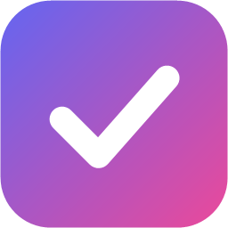

# Todo Tracker

**The to-do list that tells you what to do *now*.**
Built for ADHD brains, busy weeks, and the AI agents that help you get through them.

[](https://github.com/shahabmokhtari/todo-tracker/actions/workflows/ci.yml)


[Get started](#get-started) · [Use it with AI](#your-ai-can-use-it-too) · [Guide](docs/guide.md) · [Docs](#documentation)

<picture>
  <source media="(prefers-color-scheme: dark)" srcset="docs/images/today-dark.png">
  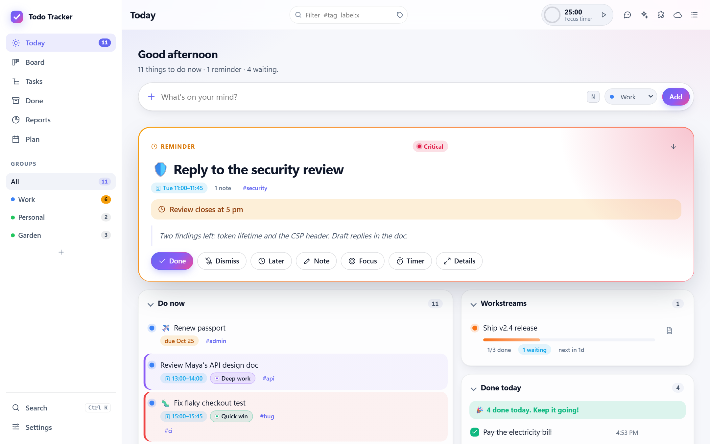
</picture>

</div>

## Why Todo Tracker

Most task apps show you everything, all the time. Todo Tracker shows you **one thing to do now**, and keeps the rest
calm until it matters.

- 🎯 **One focus, not fifty.** A big card says what to do now. The rest waits below, in the order *you* chose.
- 💤 **Later means later.** Snooze to "tomorrow 9:00", "next week", or "after the other task is done". It disappears
  and comes back on time, with a reminder. Nothing rots at the top of a list.
- 🪜 **Big things get small.** Break work into steps that unlock one at a time: perfect for rollouts ("ring 1 tomorrow").
- ⏱️ **Focus and time, built in.** A focus timer with a full-screen break on every monitor, a timer on every task, and
  reports that show where your week actually went.
- ⚡ **Plan for the energy you have.** Mark draining tasks ⚡⚡⚡ and easy ones ⚡; each day adds up what its plan takes
  and tells you before you've planned more than you have.
- 🤖 **Your AI agent's favorite to-do list.** Claude, Copilot, ChatGPT and VS Code can see your list, capture tasks,
  log progress and plan your day: through MCP, a CLI, or a skill.
- 📁 **Your tasks are your files.** Plain markdown in a folder you own. Open it in Obsidian, version it with git, sync
  it however you like. No account, no cloud, no telemetry.

## A quick tour

| Board | Plan your day or week |
|---|---|
| 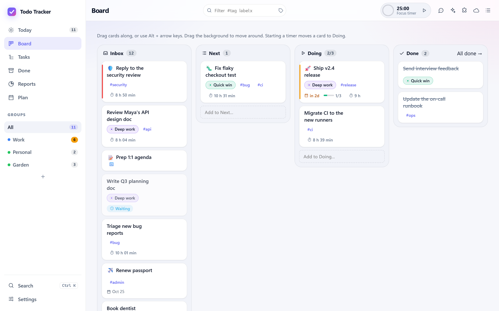 | 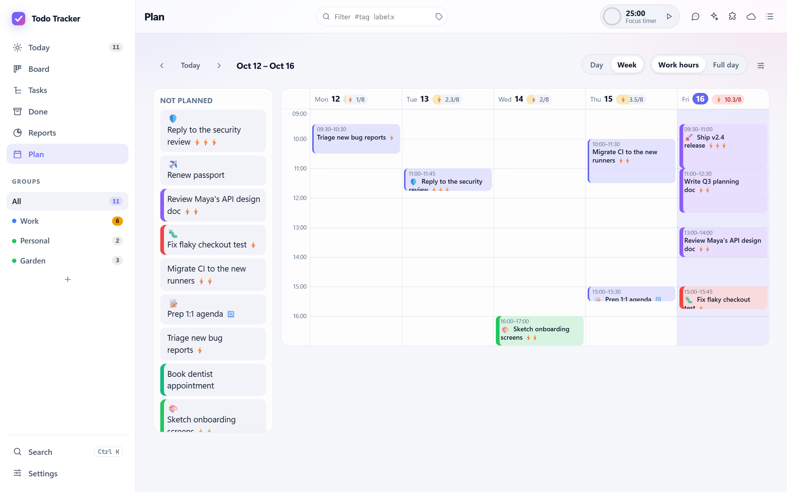 |
| **Drag cards** along, or use the keyboard. Doing is kept to three, on purpose. | **Drag a task onto a time** to block it out; while the block is on, it's the thing to do now. |

| Reports | Every task, as an outline |
|---|---|
| 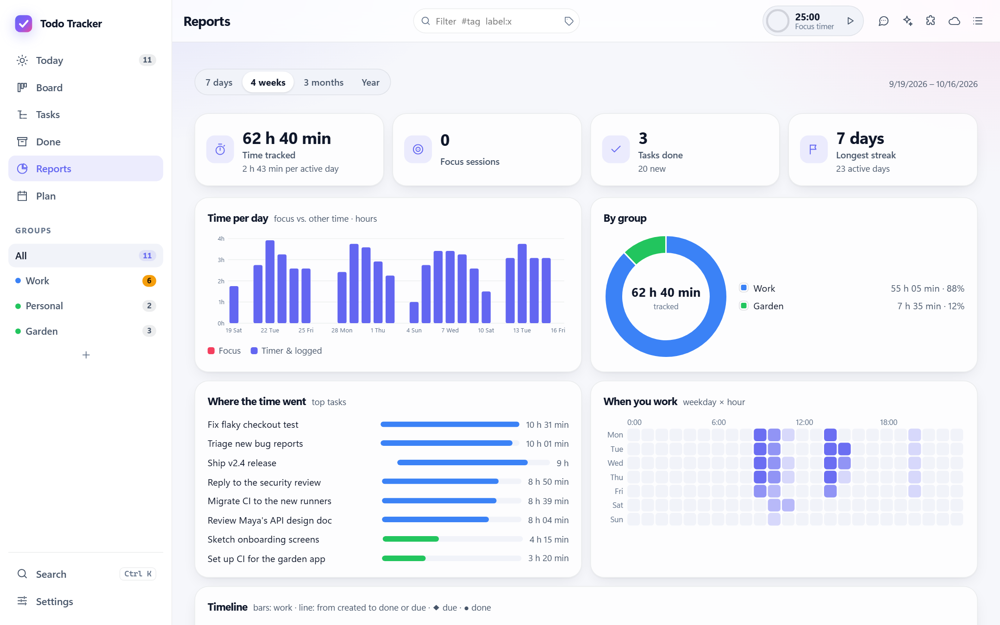 | 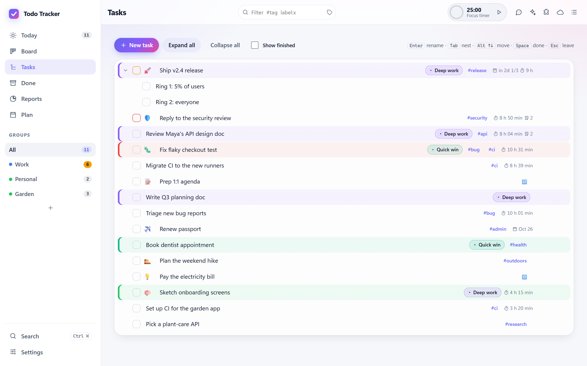 |
| See **where the time went**: by day, group and task, and when you work best. | **Type an outline**: Enter for the next task, Tab to nest, Space to finish. |

| Everything about a task | The Windows sidebar | On your phone |
|---|---|---|
| 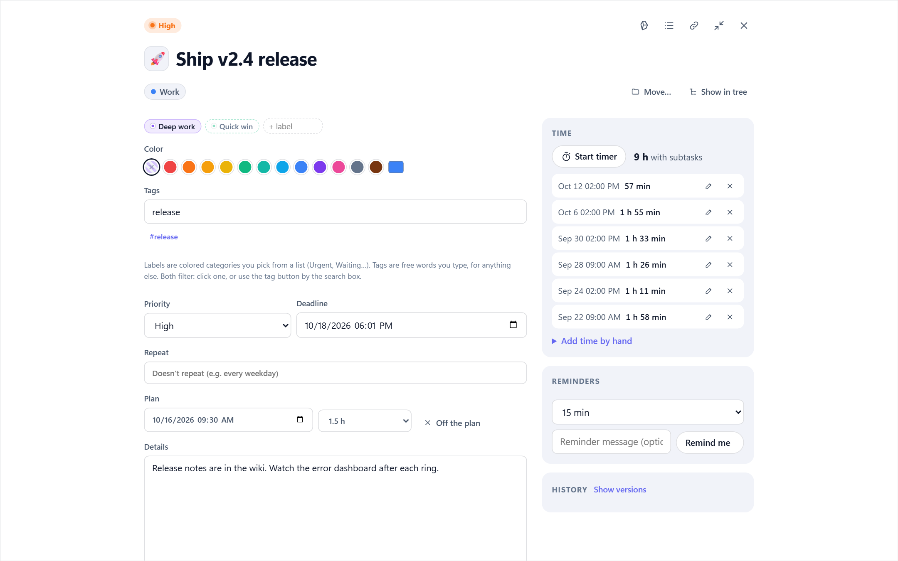 | 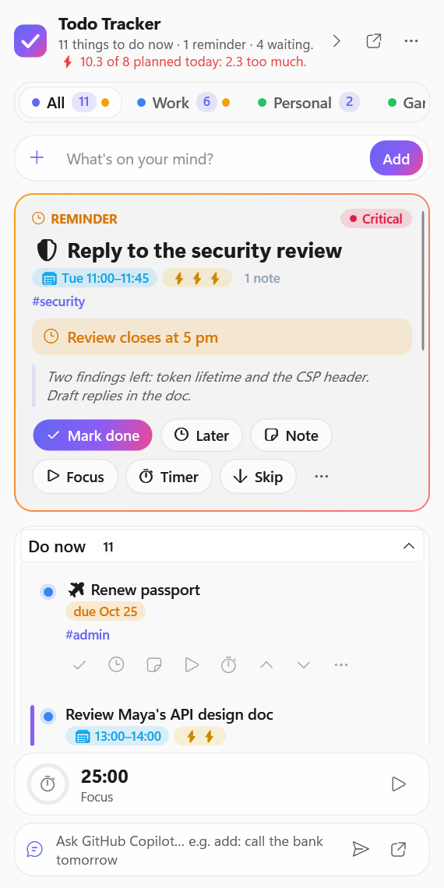 | 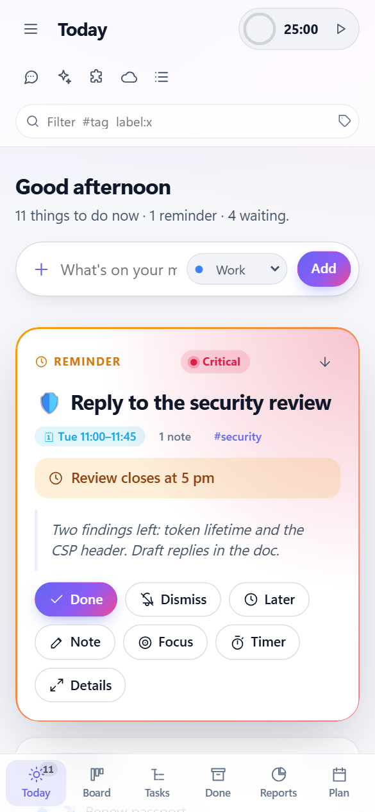 |
| Icons, colors, labels, repeat rules, a time log and **version history**. | **Docked to your screen edge**: maximized windows don't cover it. | The full app on any phone; native Android and iPhone apps too, and an iPhone or iPad can use your computer's tasks over Wi-Fi or Tailscale. |

<details>
<summary>More: dark mode, the sidebar in dark, the Mac and iPhone app, the browser extension</summary>

| Dark mode | Sidebar, dark |
|---|---|
| 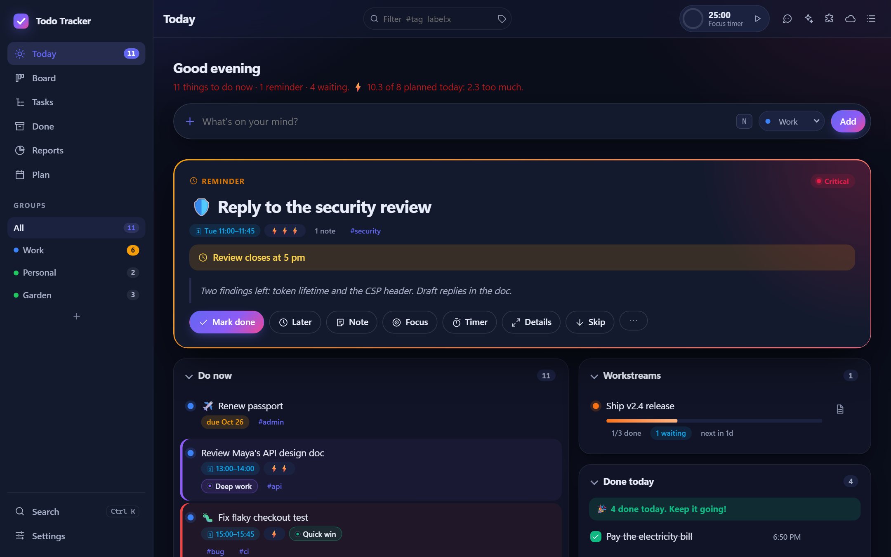 | 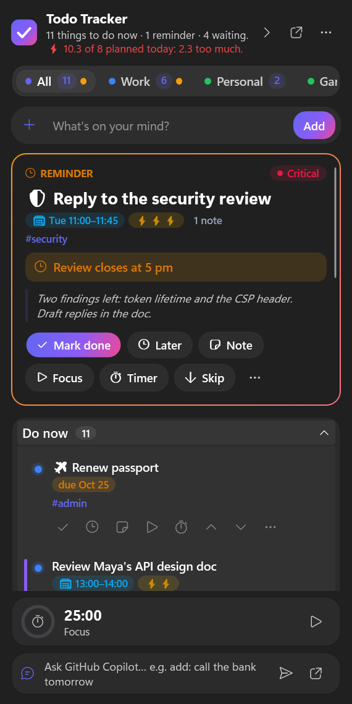 |

| Mac and iPhone (SwiftUI) | Browser side panel |
|---|---|
| 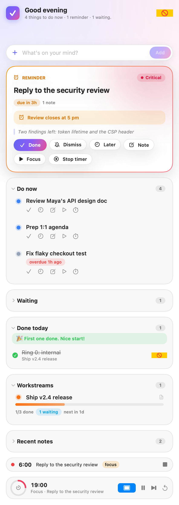 | 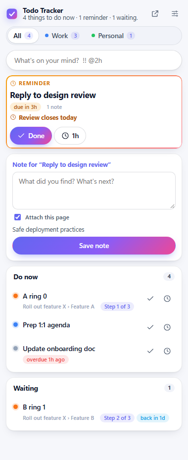 |

</details>

*Every screenshot shows a made-up demo board (`node tests/e2e/screenshots.mjs` makes them).*

## Your AI can use it too

Todo Tracker speaks **MCP**, so your AI agent can work with your list like a good assistant: capture what you said in
a meeting, tell you what to do next, break a project into steps, log what it did, and snooze what can wait.

> **You:** what should I work on now?
> **Agent:** *Reply to the security review*: it's critical and the review closes at 5 pm. Two findings are left; want
> me to draft the replies?

> **You:** add follow-ups from this meeting: send Maya the API notes by Friday, book the offsite, ask IT about runners
> **Agent:** Added three tasks to Work: *Send Maya the API notes* (due Fri), *Book the offsite*, *Ask IT about runners*.

Connect it in one line:

```bash
claude mcp add todo-tracker --scope user -- tt mcp          # Claude Code
copilot plugin install todo-tracker@todo-tracker            # GitHub Copilot CLI (after: copilot plugin marketplace add shahabmokhtari/todo-tracker)
```

…or **⋯ › Connect an AI app** in the app, which writes the setup for Claude Desktop, VS Code, Cursor and others. Every
change an agent makes is **attributed to it and versioned**, there's deliberately **no delete tool**, and hooks an
agent adds wait until you allow them.

📚 [Connect an AI app](docs/ai-connectors.md) · [MCP tools](docs/mcp.md) · [`tt` commands](docs/cli.md) ·
[The skill](integrations/agent-plugin/skills/todo-tracker/SKILL.md) · [`llms.txt`](llms.txt)

## Your tasks are just files

```
Documents/Todo Tracker/
├── Work/
│   ├── Ship v2.4 release.md        ← one file per task: frontmatter, steps as checkboxes, notes as callouts
│   └── Reply to the security review.md
└── Personal/
    └── Renew passport.md
```

- **Obsidian-friendly:** point the app at your vault and every task opens in Obsidian.
- **Version history:** every change is a version you can look at and restore.
- **Sync your way:** OneDrive, iCloud Drive or a private GitHub gist, merging changes made on two computers.
- **Or live on GitHub:** each group can be a private GitHub repository with tasks as issues (snoozes and reminders as
  labels), made for you with the GitHub CLI. [More](docs/connectors.md#github-issues)
- **Connectors:** keep a group in step with Notion or Microsoft To Do, both ways, never deleting anything.

## Everywhere you work

| | |
|---|---|
| **Windows** | A native sidebar docked to the screen edge, toasts, `Ctrl+Alt+Space` quick capture, the whole app in its own window, full-screen breaks on every monitor |
| **macOS / iOS** | Native SwiftUI apps; the Mac adds a menu bar glance |
| **Android** | A native app: Today, quick capture, every task's details, search, reminders that notify you even with the app closed, snooze, notes, task timers and the focus timer with full-screen breaks; or your computer's tasks, over Wi-Fi or Tailscale ([Phones](docs/plugins.md#phones)) |
| **Linux** | A tray app that runs everything; click it for the full window |
| **Web** | The whole app at `http://127.0.0.1:5317` (local only), on any screen |
| **Browser** | An Edge, Chrome and Safari side panel: glance, capture, and notes that keep the page you were on |
| **Terminal** | `tt now`, `tt add 'Call the bank @tomorrow'`, `tt done`, with `--json` for scripts |
| **Teams** | Reminder cards in a channel |

Type tasks the way you think: `Deploy ring 2 !! @2h due:tomorrow #release` is a critical task, back in two hours with a
reminder, due tomorrow, tagged *release*. Repeat with plain words: `every weekday`, `every month on the last Friday`.

## Get started

**Windows.** With the [.NET 10 SDK](https://dotnet.microsoft.com/download):

```powershell
git clone https://github.com/shahabmokhtari/todo-tracker && cd todo-tracker
dotnet run --project src/TodoTracker.Windows
```

The sidebar docks on the right (move it with **⋯ › Position**). Ready-built apps for every platform are attached to each
[CI run](https://github.com/shahabmokhtari/todo-tracker/actions/workflows/ci.yml) (sign in to GitHub to download):
`windows-sidebar` (the Windows app), `linux-tray`, `macos-app`, `android-app`, `browser-extension`,
`safari-extension`, and `ai-connectors` (`tt` and the Claude Desktop extension).

**Linux.** Unpack `linux-tray` and run `./install.sh` (add `--autostart` to start with your session).

**macOS / iOS.** `cd apple && brew install xcodegen && xcodegen generate && open TodoTracker.xcodeproj`.

**Anywhere (the web app, API and MCP server):**

```bash
dotnet run --project src/TodoTracker.Web -- --port 5317
```

Then read the [guide](docs/guide.md): the sidebar, the views and their keyboard shortcuts, snoozing, rollouts, links
to tasks, and more.

## Documentation

| | |
|---|---|
| [Guide](docs/guide.md) | Using every part of the app |
| [Connect AI apps](docs/ai-connectors.md) | Claude, Copilot, VS Code, ChatGPT, Copilot Studio |
| [MCP tools](docs/mcp.md) · [`tt` commands](docs/cli.md) | The full references (made from the code) |
| [Task files](docs/vault-format.md) | The markdown format, for Obsidian and agents |
| [Sync](docs/sync.md) · [Connectors](docs/connectors.md) | Your computers, Notion, Microsoft To Do, GitHub Issues |
| [Hooks](docs/hooks.md) · [Plugins](docs/plugins.md) | Automations and the event stream; every extra and its switch |
| [Browser extension](docs/browser-extension.md) | Install and pair |
| [Phones](docs/plugins.md#phones) | Let the iPhone, iPad and Android apps use this computer's tasks |
| [Product spec](docs/product-spec.md) | Design, rules, security, decisions |

## Privacy and security

Everything runs on your computer. The server only listens on `127.0.0.1`, checks the address it was called on (no DNS
rebinding) and a 256-bit token, and never puts the token in a URL. If you let phones connect (the **Phones** extra,
off by default), it also listens on port 5318 over HTTPS for phones you paired with a QR code, each with its own
token that only reaches your tasks. There's no account and no telemetry: the app only
talks to the services you switch on (sync, connectors, an AI model you add). Details:
[product spec › Security](docs/product-spec.md#8-security-local-server).

## Contributing

Issues and pull requests are welcome. [AGENTS.md](AGENTS.md) is the place to start, for people and coding agents
alike: the map of the code, how to build and test, and the rules that keep users' tasks safe. In short:

```bash
dotnet build TodoTracker.slnx -c Release -warnaserror
dotnet test --solution TodoTracker.slnx -c Release --no-build
node --test tests/web/*.test.mjs extension/tests/*.test.mjs
```
