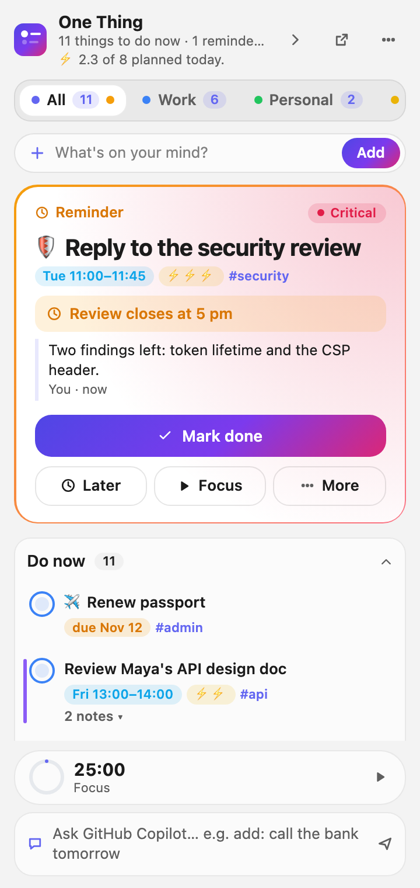
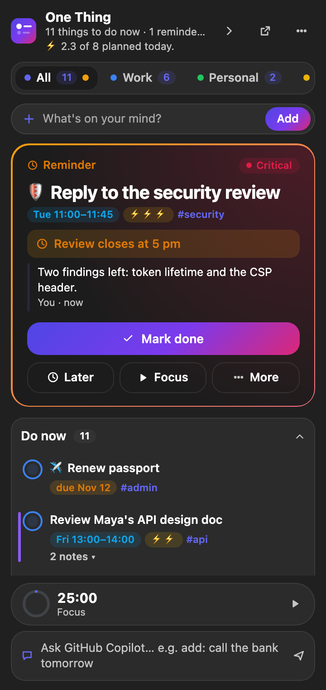
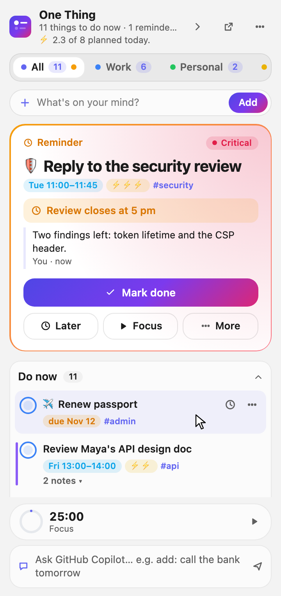
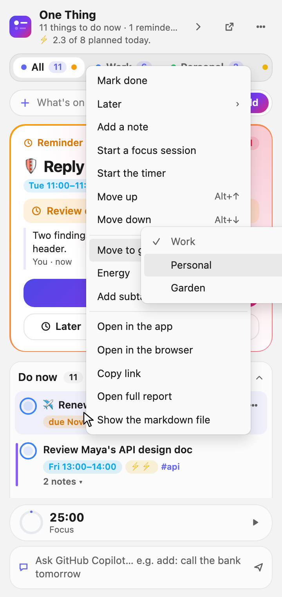
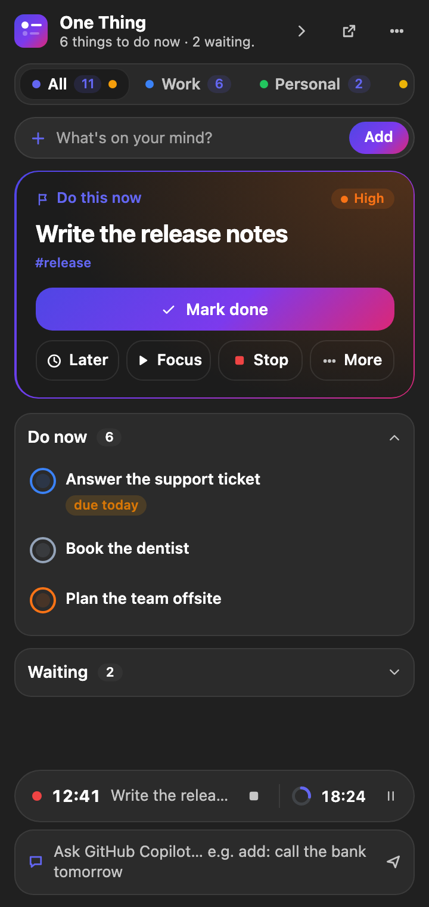
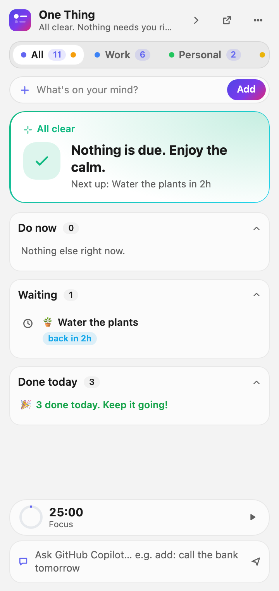

# Windows sidebar: the shared design (hand-off for a check on Windows)

**For GitHub Copilot (or anyone) on Windows.** The Windows sidebar (`src/OneThing.Windows`) was redesigned on a Mac,
where WPF compiles (`-p:EnableWindowsTargeting=true`) but can't run. Nobody has seen it yet. Your job: build it, run it
on a throwaway board, compare it with the mockups below, and fix what doesn't match. Read [AGENTS.md](../../../AGENTS.md)
first.

The design is the one the web app, the Apple apps and Android already have (see `docs/images/phone.png`,
`docs/images/today-light.png`, `src/OneThing.Server/wwwroot/css/views.css`, and
`apple/OneThingKit/Sources/OneThingUI/DashboardView.swift`, `RowActions.swift`, `Presentation.swift`):

- **Focus card ("hero"):** the one thing to do now. A brand-gradient hairline (`#4f46e5 → #7c3aed → #db2777`; amber
  for a reminder) round a calm card with a soft glow in the priority's color, a 20 px title, then **Mark done** (a
  white-on-gradient button across the card) and **Later · Focus · More** side by side. **Stop** joins them while the
  task is timed; **Note** takes Focus's place when the Focus timer plugin is off. Note, Timer and Skip moved into More.
- **Calmer rows:** a done circle in the priority's color in front (a clock for a waiting task: brings it back), no
  button strip under each row, two quiet actions on hover or keyboard focus (**Later**, **⋯**), and a context menu
  (right-click, Shift+F10, the menu key) with everything.
- **One timer strip** at the bottom: the task timer, the focus timer, or both side by side (the focus timer then
  small), the same rule as the Apple apps (`TimerStripLayout` ↔ `Presentation.timerStrip`).
- **Words:** sentence case ("Do this now", "Reminder", "All clear"), "Next up: …".
- **Themes:** light and dark (the Fluent theme's brushes; brand colors are the same in both).

## Mockups

The sidebar at its real size (360 × 760, `MainWindow.xaml` `Width="360"`), drawn at 2×. Source: [mockups.html](mockups.html)
(open it with `?state=today|hover|menu|timer|empty&theme=light|dark`); [render.mjs](render.mjs) makes the PNGs:
`cd tests/e2e && npm install && node ../../docs/design/windows-sidebar/render.mjs`.

| Today, light | Today, dark | A row pointed at |
| --- | --- | --- |
|  |  |  |

| The row's context menu | Focus timer and task timer | Nothing due |
| --- | --- | --- |
|  |  |  |

The mockups use another system font and SVG icons where Windows has Segoe UI Variable and Segoe Fluent Icons; judge
layout, spacing, color and wording, not the exact glyphs or font.

## What changed, and where

| File | Change |
| --- | --- |
| `src/OneThing.Windows/App.xaml` | `BrandGradient` is the icon's `#4F46E5 → #7C3AED → #DB2777`. New: `Recording` (the timer's red), `GlowMask` (radial mask for the focus card's glow), `HeroButton`, `HeroPrimaryButton`, `DoneCircle` (ring in the button's `Foreground`, fills and shows ✓ on hover), `Eyebrow`. |
| `src/OneThing.Windows/MainWindow.xaml` | `CardTemplate`: done circle / clock / priority dot in front; the 10-button strip is gone; **Later** + **More** (`x:Name="Actions"`, opacity 0 until hover or focus); **Stop timer** stays while timing; an empty `<ContextMenu/>` placeholder and `ContextMenuOpening="OnCardContextMenuOpening"`. `FocusTemplate`: corner 20, glow layer, sentence-case eyebrow, Mark done across, then a `UniformGrid` of Later · Focus/Note · Stop · More. Empty card: "All clear" eyebrow and "Next up" or "Capture the next thing…". Do now: "Nothing else right now." when only the focus card is left. Bottom: the two timer cards became one strip bound to `TimerStrip`. |
| `src/OneThing.Windows/MainWindow.xaml.cs` | `TaskMenuAsync` builds the one task menu (used by More and the context menu): Dismiss reminder; (context menu only) Mark done, Bring back, **Later ›** (same choices as the Later button); Add a note; Start a focus session; Start/Stop the timer; Skip for now (focus card) or Move up/down (rows); **Move to group ›**; Energy ›; Add subtask…; Open in the app/browser, Copy link, Open full report, Obsidian, Show the markdown file. `AddLaterChoicesAsync` is shared with the Later button. A note box keeps its own Cut/Copy/Paste menu (`IsInsideTextBox`). |
| `src/OneThing.Desktop/ViewModels.cs` | `TimerStripLayout` (the strip's rule), `GroupMoveRequest`, `GroupMoveTarget`; `CardViewModel.GroupId`, `CanChangeGroup`. |
| `src/OneThing.Desktop/SidebarViewModel.cs` | `TimerStrip` (updated on refresh and when the Focus timer plugin turns on or off), `MoveTargetsAsync`, `MoveToGroupCommand` (as you, "Moved to Work"), `NextUpText` says "Next up: …". |
| `tests/OneThing.Desktop.Tests/SidebarRedesignTests.cs` | The strip's rule (every case), the strip following timers and the plugin, Move to group (targets, the move, none for a subtask), "Next up". |
| `docs/guide.md`, `docs/product-spec.md` | The sidebar's new layout. |

**Kept on purpose:** every binding and command the old XAML used, `x:Name`s (`CaptureBox`, `CollapseButton`,
`ExpandButton`, `PomodoroRing`, `Status`, `EnergyLine`, `AskBox`, `AskMessage`, `ActiveTask`, `FullView`,
`CompactView`, `Actions`, `Eyebrow`, `EyebrowGlyph`, `Frame`, `CardBorder`), the window's and header's automation
names (`One Thing sidebar`, `Menu`, `Collapse`, `Expand`, which `tests/system/*.ps1` use, and `Open dashboard`,
`Quick add task`, `Add group`, untouched), the main menu (Position, Always on top, Hide the sidebar…), and the names of the buttons that are still buttons (`Mark done`, `Bring back`, `Snooze`,
`More`, `Stop timer`, `Focus`, `Add note`, `Notes`, `Note`, `Finish note`, `Stop the timer`, `Start focus`, `Pause`,
`Resume`, `Skip`, `Reset`, `Focus timer`). **Gone as buttons** (now menu items): a row's `Add note`, `Focus`,
`Start timer`, `Move up`, `Move down`; the focus card's `Start timer` and `Skip`. No test looks for them (checked with
grep over `tests/`).

## Not verified (nobody has seen it on Windows)

- That the window opens at all: a wrong `StaticResource` key or a bad template throws only at run time
  (`XamlParseException`). The keys were checked by script; the rest wasn't.
- Every look: spacing, sizes, the glow (`OpacityMask` with `GlowMask` over a priority-tinted layer), the done circle,
  how Fluent draws `HeroButton` borders in dark, the strip's divider and small ring.
- `UniformGrid Rows="1"` giving collapsed buttons no cell (Focus *or* Note, Stop only while timing).
- The context menu: right-click and Shift+F10 open the built menu (not the empty placeholder), at the pointer for a
  right-click and under the row for the keyboard; a right-click in a note box still shows Cut/Copy/Paste.
- Hover actions show on hover and on keyboard focus (Tab into a row), and stay shown on a reminder row.
- Move to group: the current group checked and greyed out; a subtask shows no Move to group.
- The timer strip in each case: idle (focus only, Play), focus running alone (ring, time, label, Pause, Skip, Reset),
  a task timed (dot, time, title, Stop, then small focus ring/time/Play, and while it runs a ⋯ with the phase, Skip
  and Reset), both running, and the Focus timer plugin off.
- Drag to reorder still starts from a row's empty area and not from the done circle or the hover buttons.
- Dark mode contrast of `Accent` text (`#6366F1`) on the dark card, and of the white title text on the hero.
- The compact 56 px strip and peek (not changed, but they share the window).

## Build and run it safely

Never point it at your own tasks. From the repo root, in PowerShell:

```powershell
# 1. Quit a running sidebar first: only one runs at a time (a second start hands over to the running one).
#    Tray icon › Exit, or:
Get-Process OneThing -ErrorAction SilentlyContinue | Stop-Process

# 2. Build (warnings are errors) and run the tests
dotnet build OneThing.slnx -c Release -warnaserror
dotnet test --project tests/OneThing.Desktop.Tests -c Release --no-build

# 3. The smoke test: boots the real app on a temporary board and checks the API and the sidebar see the same data
$exe = "src/OneThing.Windows/bin/Release/net10.0-windows10.0.19041.0/OneThing.exe"
& $exe --smoke-test --smoke-log smoke.log; Get-Content smoke.log
#    With --screenshot it also seeds a demo board and saves light and dark pictures of the sidebar:
& $exe --smoke-test --smoke-log smoke.log --screenshot "$env:TEMP\sidebar.png"

# 4. Try it by hand on a throwaway folder (ONETHING_VAULT wins over --data, so clear it)
$data = Join-Path $env:TEMP ("onething-try-" + [guid]::NewGuid())
Remove-Item Env:ONETHING_VAULT -ErrorAction SilentlyContinue
$env:ONETHING_CLOUD = "off"
& $exe --data $data
#    Add tasks with quick add, or seed the demo board through the API the way SeedDemoAsync (App.xaml.cs) does.
#    Theme: ⋯ › Theme › Light / Dark.

# 5. The system tests (they take over the screen and keyboard for a while; not while you work)
pwsh tests/system/placement.system-test.ps1 -Exe $exe
pwsh tests/system/fullscreen.system-test.ps1 -Exe $exe
# multimonitor.system-test.ps1 needs two monitors

# When you're done: quit it, start your own sidebar again, delete $data.
```

## Checklist: each mockup against the real app

Take the light and dark screenshots from step 3 (or by hand at 100% scaling), put them next to the mockups, and tick:

**Today (light and dark): `today-light.png`, `today-dark.png`**
- [ ] Focus card: gradient hairline (indigo → violet → pink), amber for a reminder; corner radius about 20.
- [ ] A soft glow in the priority's color, top right, fading by the middle; none behind the text that hurts reading.
- [ ] Eyebrow "Do this now" / "Reminder" in sentence case, the priority pill on the right.
- [ ] Title 20 px bold; chips, tags, reminder banner and notes as before.
- [ ] **Mark done** spans the card, white on the gradient.
- [ ] **Later · Focus · More** one row, equal widths, no clipped text at 360 px (also at 125% and 150% scaling).
- [ ] Rows: a 22 px circle in the priority's color in front, no button strip under any row.
- [ ] Section headers sentence case ("Do now", "Waiting", "Done today", "Workstreams", "Recent notes").
- [ ] Dark: card, text, chips and buttons readable; the hairline and glow still visible but not loud.

**A row pointed at: `row-hover.png`**
- [ ] The row tints; **Later** (clock) and **⋯** show at its top right; nothing else appears.
- [ ] Pointing at the circle fills it and shows a white ✓; clicking it marks the task done.
- [ ] Tab into a row: the two actions show too (keyboard).
- [ ] A row being timed keeps a red **Stop** visible without hover.
- [ ] A waiting row shows a clock in front; clicking it brings the task back.

**Context menu: `context-menu.png`**
- [ ] Right-click a row: the full menu at the pointer (Mark done, Later ›, Add a note, Start a focus session, Start the
      timer, Move up/down, Move to group ›, Energy ›, Add subtask…, Open in the app, Open in the browser, Copy link,
      Open full report, Show the markdown file).
- [ ] **Later ›** has the same choices as the Later button, then Pick a time…, After another task ›.
- [ ] **Move to group ›** lists the groups, the current one checked and greyed; picking one moves the task (the status
      line says "Moved to …", the tab counts change). A subtask has no Move to group.
- [ ] Shift+F10 on a focused row opens it too; right-click in a note box shows Cut/Copy/Paste instead.
- [ ] **⋯** (row) and **More** (focus card) open the same menu without Mark done and Later; the focus card's has
      **Skip for now** (Alt+↓) when there's something to skip to.

**Focus timer running: `focus-timer.png`**
- [ ] **Focus** on the card: the strip shows the task timer (red dot, time, title, Stop) and, after a thin divider,
      a small ring, the focus time and Pause. The card shows **Stop** between Focus and More.
- [ ] A focus session with no task (tray › Start focus): the strip shows only the focus timer: a 30 px ring, time,
      "Focus", Pause, Skip, Reset.
- [ ] Nothing running: the strip shows the idle focus timer (25:00, Play). With the Focus timer plugin off and nothing
      timed, there's no strip at all.
- [ ] The collapsed 56 px strip still shows the focus ring and time.

**Nothing due: `empty.png`**
- [ ] The green "All clear" card: "Nothing is due. Enjoy the calm." and "Next up: … in 2h" (or "Capture the next
      thing whenever it comes to mind." when nothing waits).
- [ ] Do now says "Nothing else right now." when the focus card is the only task, and when there are none.

**Once it matches:** regenerate the sidebar's pictures on Windows (`cd tests/e2e && node screenshots.mjs --only
windows-sidebar,windows-sidebar-dark`, sidebar quit first) so `docs/images/windows-sidebar*.png` and the README show
the new look, and commit them with your fixes.

## Known risks in the blind changes

1. **Run-time XAML errors.** WPF checks resource keys, template parts and binding paths only when the window loads.
   The smoke test catches a window that fails to load; a broken binding just shows nothing (look at the Output
   window for `System.Windows.Data Error`).
2. **The context menu placeholder.** Each row and the focus card carry an empty `<ContextMenu/>` so WPF raises
   `ContextMenuOpening`; the handler marks it handled and opens a built menu. If WPF ever shows the empty one (a thin
   empty popup), the handler isn't running or isn't marking it handled.
3. **The glow.** `OpacityMask` with a `RadialGradientBrush` on a rounded `Border`; if it looks banded or covers the
   whole card, lower its alpha (`ConverterParameter=60` on the `SoftBrush` layer in `FocusTemplate`) or drop the layer.
4. **`UniformGrid` and collapsed children.** WPF's `UniformGrid` skips collapsed children when it counts columns;
   if a gap shows where Focus/Note/Stop is hidden, use a `Grid` with star columns instead.
5. **The hero's four buttons at 360 px** (while a task is timed) may clip at 150% scaling; shorten to icons-only for
   Stop if they do.
6. **Opacity-0 hover actions are still clickable** (as before: the old strip was at 55%). That keeps them reachable
   by keyboard and screen readers; a click on the empty top-right corner of a row hits Later or More.
7. **Fewer buttons for UI Automation.** A row's Add note, Focus, Start timer, Move up and Move down are menu items
   now. Scripts that clicked them by name must open the row's menu (⋯ or right-click) first.
8. **`Accent` (`#6366F1`) in dark mode** is a little dim for small text on `#1C1C1C`; the other apps lighten it in
   dark (`#A5B4FC`). If it reads poorly, give WPF a theme-aware accent brush.
9. **The hero is a hairline card, not a solid gradient.** That's what the web and Apple apps ship (white text only on
   Mark done). If a solid gradient card with white text is wanted instead, it's one change: the inner `Border`'s
   background in `FocusTemplate` (and every text brush on it).
